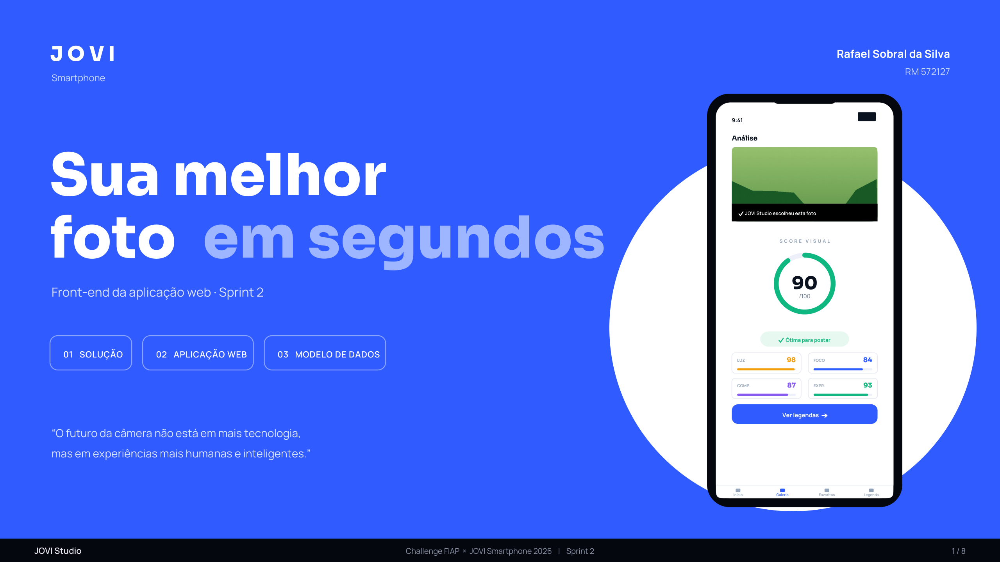
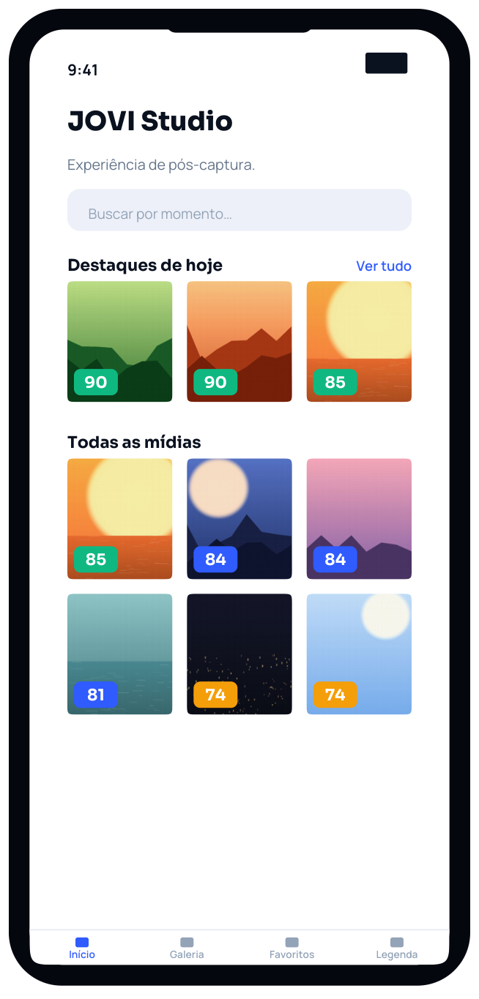
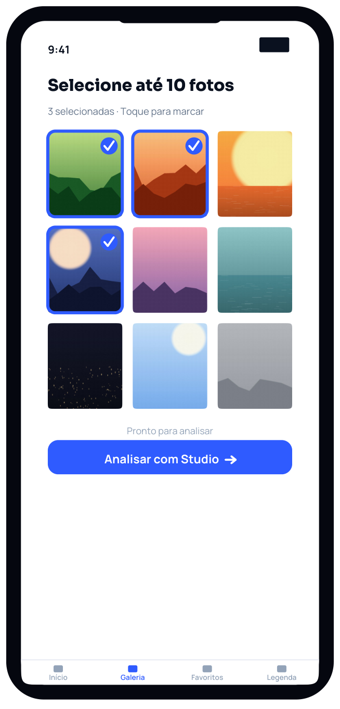
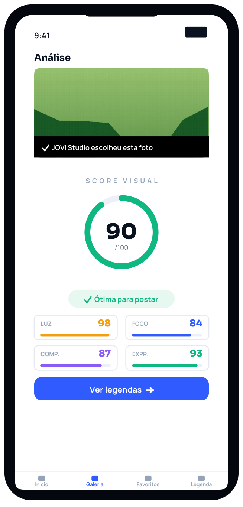
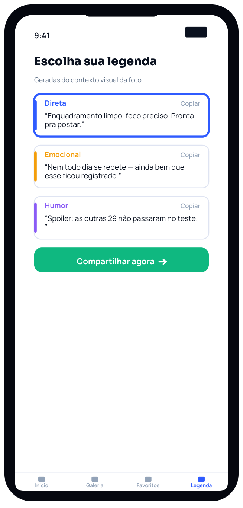
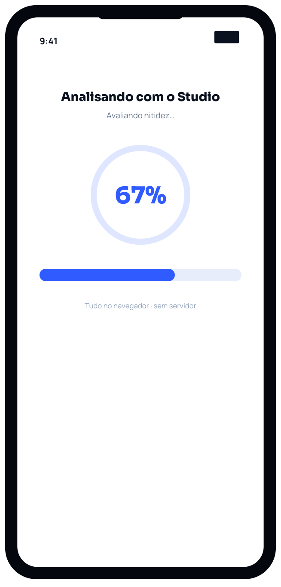
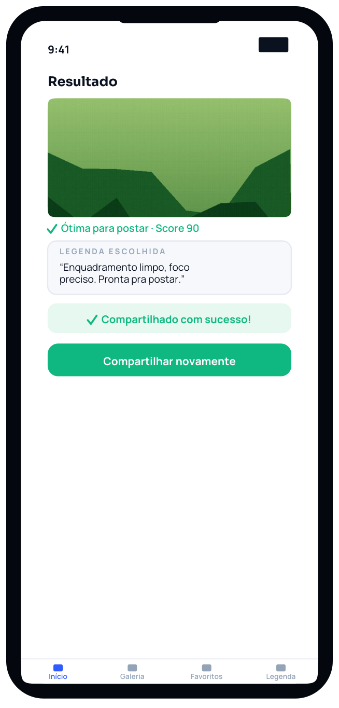

# JOVI Studio

### Sua melhor foto, em segundos — direto no navegador.

Experiência web **mobile-first** de **pós-captura**: o usuário seleciona as fotos, o app pontua cada uma com um **Score Visual real (0–100)** calculado nos próprios pixels, sugere legendas e leva ao compartilhamento — tudo client-side, sem servidor e sem upload de imagem.




> **Demo ao vivo:** [rafaelsobral2-pixel.github.io/jovi-studio](https://rafaelsobral2-pixel.github.io/jovi-studio/)

---

## Sobre o projeto

O **JOVI Studio** nasceu no **Challenge FIAP × JOVI Smartphone 2026**, cujo objetivo é melhorar a experiência de câmera e consumo de conteúdo nos smartphones JOVI. Em vez de mais uma câmera, a aposta é no momento **depois** da foto — onde a maioria das pessoas trava: *"tirei 30 fotos, qual eu posto?"*.

A resposta é uma jornada de cinco pilares, fluida e sem atrito, que cabe inteira no navegador do celular.

## A jornada — 5 pilares

| # | Pilar | O que faz |
|---|-------|-----------|
| 01 | **Seletor Inteligente** | Compara até 10 fotos e elege a melhor. |
| 02 | **Score Visual 0–100** | Pontua luz, foco, composição e expressão via Canvas. |
| 03 | **Legenda com IA** | Três estilos (Direta, Emocional, Humor), copiadas com um toque. |
| 04 | **Compartilhamento** | Web Share API nativa, com *fallback* de cópia. |
| 05 | **Performance percebida** | Skeleton, barra de progresso e toast de sucesso. |

## Telas

| Galeria | Seletor | Score Visual | Legenda |
|:---:|:---:|:---:|:---:|
|  |  |  |  |

| Processando | Concluído |
|:---:|:---:|
|  |  |

## Como funciona o Score Visual

O score **não é aleatório**. O app desenha a imagem num `<canvas>`, reduz para no máximo 224px (análise rápida e estável) e calcula quatro heurísticas sobre os pixels:

| Métrica | Peso | Como é medida |
|---------|:----:|---------------|
| **Luz** | 0.28 | Exposição / luminância média (penaliza foto escura ou estourada). |
| **Foco** | 0.30 | Nitidez pela **variância do Laplaciano** (borda nítida ⇒ alta variância). |
| **Composição** | 0.24 | Contraste global + energia na **regra dos terços**. |
| **Expressão** | 0.18 | Vivacidade de cor e contraste na região central. |

O total ponderado (0–100) elege a melhor foto e gera uma **justificativa legível** ("Ótima para postar", etc.). As legendas são determinísticas: derivam de um *seed* calculado a partir do próprio resultado do score, então a mesma foto sempre recebe as mesmas sugestões.

Tudo roda **offline, no cliente** — nenhuma imagem sai do dispositivo.

## Stack técnica

Estritamente dentro do escopo do challenge:

- **HTML5** — estrutura semântica das telas e da navegação.
- **CSS3** (autoral) — frame do device, *gauge* do score, skeleton, toast e animações, com `prefers-reduced-motion`.
- **JavaScript** (vanilla) — roteamento de telas, jornada dinâmica e o Score Visual via **Canvas API**.
- **Tailwind CSS** — utilitários e tema de marca JOVI, **compilado localmente** (sem CDN).

Sem frameworks externos, sem CDN, sem dependências de runtime. Fontes (Sora + Manrope) e fotos-demo vêm **embutidas** no projeto, então ele funciona 100% offline.

## Modelagem de dados (MER)

O modelo lógico (7 entidades, 3ª Forma Normal, mapeado nos 5 pilares) foi entregue na Sprint 1 e está documentado na apresentação:

📄 [`docs/JOVI_Studio_Sprint2_Apresentacao_RM572127.pdf`](docs/JOVI_Studio_Sprint2_Apresentacao_RM572127.pdf)

Entidades: `TB_USUARIO`, `TB_SESSAO`, `TB_FOTO`, `TB_SCORE`, `TB_LEGENDA`, `TB_COMPARTILHAMENTO`, `TB_LOG_PERFORMANCE`.

## Como rodar localmente

Não precisa de build nem de servidor. Basta abrir o `index.html`:

```bash
# opção 1 — abrir direto
# dê duplo clique em index.html

# opção 2 — servidor local (recomendado: habilita o Score Visual e a Web Share API)
python3 -m http.server 8000
# acesse http://localhost:8000
```

> As fotos-demo estão embutidas como data URI, então o Score Visual funciona mesmo abrindo o arquivo direto. Servir por `http://` apenas garante o comportamento idêntico ao de produção.

Para a melhor experiência, abra as DevTools do navegador e ative o **modo dispositivo** (mobile) — o app é mobile-first.

## 🚀 Deploy no GitHub Pages

Como é 100% estático, publicar é gratuito e leva dois minutos:

1. Suba este repositório para o GitHub (veja abaixo).
2. No repositório: **Settings → Pages**.
3. Em **Source**, escolha **Deploy from a branch**.
4. Branch: **`main`** · pasta: **`/ (root)`** → **Save**.
5. Em ~1 minuto o app estará no ar em `https://rafaelsobral2-pixel.github.io/jovi-studio/`.
6. Atualize o link da **Demo** no topo deste README.

## Estrutura do projeto

```
jovi-studio/
├── index.html              # entrada — todas as telas (SPA vanilla)
├── css/
│   ├── style.css           # estilo autoral (device, gauge, skeleton, toast)
│   └── tailwind.css         # Tailwind compilado localmente
├── js/
│   ├── app.js              # roteamento de telas e jornada
│   ├── scoring.js          # Score Visual via Canvas API
│   ├── captions.js         # geração de legendas
│   └── data.js             # fotos-demo (embutidas) e estado
├── assets/
│   ├── favicon.svg
│   └── fonts/              # Sora + Manrope (woff2, embutidas)
├── docs/
│   └── JOVI_Studio_Sprint2_Apresentacao_RM572127.pdf
└── screenshots/
```

## Autor

**Rafael Sobral da Silva** — RM **572127**
1º ano · Análise e Desenvolvimento de Sistemas · **FIAP**
Challenge FIAP × JOVI Smartphone 2026 — Sprint 2

<!-- LinkedIn: https://www.linkedin.com/in/SEU-PERFIL -->

---

<sub>Projeto acadêmico desenvolvido para o Challenge da FIAP em parceria com a marca JOVI. Marcas e nomes citados pertencem aos seus respectivos donos.</sub>
